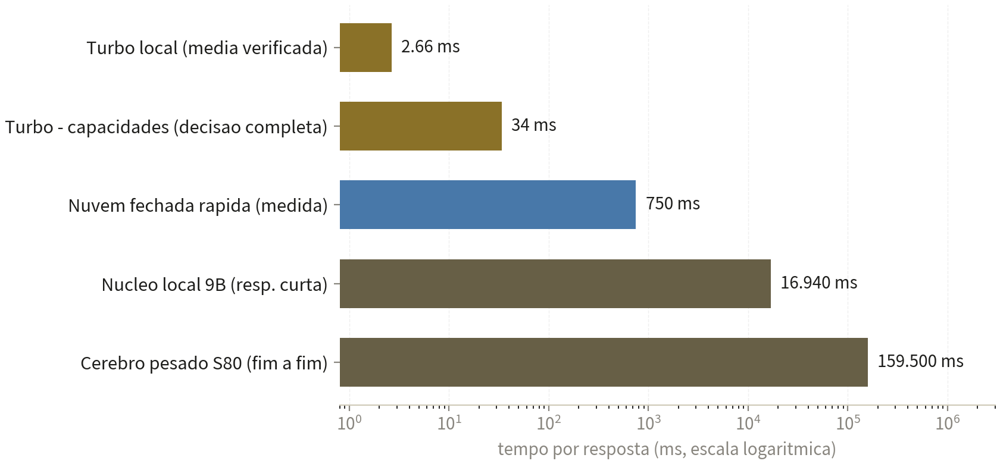
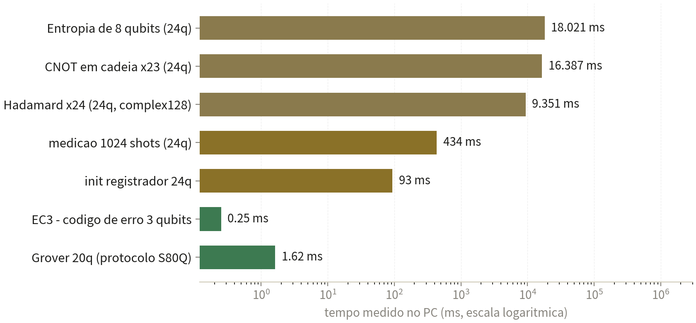

<h1 align="center">🇧🇷 IA BRASIL — Pilha Local de 3 Cérebros</h1>

<p align="center">
  
</p>

> **Propriedade intelectual de Samuel Ribeiro Fernandes** — © 2026, todos os direitos reservados.
> Benchmark 100% com dados reais, medidos na própria máquina em 05/11/2026, entre 20:31 e 21:20 (hora local).

---

## ⚡ O feito em números

| | |
|---|---|
| **2,66 ms** | tempo médio por resposta **provada** (turbo local, 2 caminhos independentes) |
| **~280 x** | mais rápido que a nuvem fechada medida (0,75 s) na mesma conta |
| **100% offline** | nada sai do PC: sem API, sem internet, sem chave |
| **24 qubits** | simulador quântico de estado vetorial rodando no mesmo PC |

**A conta de calibragem** (47 × 23 + 150, resultado correto: **1231**) foi proposta a todas as camadas:

| Camada | Resposta | Tempo |
|---|---|---|
| **Turbo local** (resposta provada) | ✅ **1231** | **3 ms** |
| Núcleo local 9B (sem verificação) | ❌ 1097 — ERRO | 21,9 s |
| Nuvem fechada rápida (amostra anônima) | ❌ 1131 — ERRO | 0,75 s |

A pilha local entregou a resposta **correta e verificada**, cerca de **280 vezes mais rápido** que a nuvem medida — rodando num PC de 2012, sem depender de rede.

---

## 🧠 Arquitetura: os 3 cérebros

| Camada | Componente | Papel | Latência medida |
|---|---|---|---|
| **Cérebro 1** | Turbo: motor de raciocínio provado + pacote de capacidades (10 módulos) | Aritmética exata, sequências, silogismos, idades, probabilidade, código executado antes de sair, memória que aprende, planejador, agentes | **0,87 a 39,4 ms** |
| **Cérebro 2** | Núcleo: servidor de inferência local com modelo 9B (quantização 4-bit) | Geração geral de linguagem, contexto de 32.768 tokens, API de chat, interface web própria | 16,9 s (resposta curta); 2,1–2,3 tok/s |
| **Cérebro 3** | Pesado: S80 (24 qubits) + memória episódica | Diversificação quântica de hipóteses, relembramento episódico e mensagens neurais antes da geração | Preparação 3,3 ms; ponta a ponta 159,5 s |

O roteador entra em ação na ordem: **turbo primeiro** (responde ou recusa honestamente), **pacote de capacidades** em seguida, **caminho pesado S80** quando o usuário pede profundidade, e **núcleo de geração** como base universal. Recusas honestas não são entregues ao usuário: caem fora e deixam o próximo cérebro agir.

---

## 📈 Latência por camada (medida, escala logarítmica)



## ⚛️ Kernel S80 — custo real por operação (24 qubits)



A camada de protocolo (Grover de 20 qubits em **1,62 ms**, correção EC3 em **0,25 ms**) é instantânea porque opera sobre estruturas enxutas; já a manipulação do vetor completo de **16,7 milhões de amplitudes** (complex128) custa segundos por porta — os números reais da parede exponencial num CPU de 2012 sem AVX2.

| Qubits | Amplitudes (2ⁿ) | RAM por registrador | Viabilidade no PC de teste |
|---|---|---|---|
| 24 (limite atual) | 16.777.216 | 268 MB | ✅ Real e medido |
| 26 | 67.108.864 | 1,07 GB | Viável com ajuste |
| 30 | 1.073.741.824 | 17,2 GB | Não cabe nos 16 GB |
| 40 | 1.099.511.627.776 | 17,6 TB | Impossível em CPU clássica |

---

## 🔩 S40 / S80 / S160 — os kernels do projeto

- **S40 — o cofre de memória episódica.** Formato próprio `S80-MEMORY/1`: guarda episódios gerados pela rota S160 (estratégia, pergunta, resposta, confiança, geração) e catálogos de parâmetros de modelos, incluindo um registro completo de 4,02 bilhões de parâmetros com metadados de arquitetura. Ciclo gera → guarda → aprende.
- **S80 — o simulador quântico de 24 qubits.** Registrador de estados em vetor de amplitudes complexas (complex128), 16 portas de 1 e 2 qubits (H, X, Y, Z, S, T, RX, RY, RZ, P, CNOT, CZ, CP, SWAP, CCX, CSWAP), oráculo de fase, entropia, medição por amostragem e colapso, paridade, valor esperado Z, fidelidade e código de correção de 3 qubits (EC3). O protocolo **S80Q** expõe 14 operações remotas (Grover, Bernstein-Vazirani, QFT, swap test, kernel…).
- **S160 — o orquestrador completo.** Amarra tudo: motor de linguagem local (catálogo com um modelo de 9B e um de 4B), rota S80 acoplada, motores MOTOR-QUANTICO e QX-NUCLEAR, PATCH-RACIOCINIO-REAL (7 fases com verificação), duelos entre IAs, treinamento e memória persistente. ~0,97 GB de projeto.

**Em resumo: o S40 lembra, o S80 calcula, o S160 comanda.**

---

## 🖥️ Hardware do teste (100% real, nada de nuvem)

| Item | Valor |
|---|---|
| Máquina | Intel Core i7-3770 (4 núcleos / 8 threads, 3,4 GHz, Ivy Bridge, **SEM AVX2**) — PC de **2012** |
| RAM | 16 GB total; 4,8 GB livres durante os testes |
| GPU | GT 610 1 GB (nenhum papel no processamento de IA) |
| SO | Windows x64, Python 3.12 — sem dependências externas no turbo |

## 📊 Comparativo por classe de IA

| Classe | Tamanho típico | Latência típica | Medido aqui | Offline? |
|---|---|---|---|---|
| **Pilha IA Brasil (3 cérebros)** | 5,75 GB RAM no núcleo + 218 KB de kernels + 180 KB de turbo | 0,003–0,6 s (turbo) até 160 s (pesado) | ✅ Completa (turbo, núcleo, pesado, S80) | **Sim, 100%** |
| Nuvem fechada grande *(estimativa pública)* | centenas de GB de pesos | 1–10 s por resposta | — | Não |
| Nuvem fechada rápida *(medida, anônima)* | dezenas de bilhões de parâmetros | 0,4–2 s | 0,74–0,79 s (n=3); 1 erro de aritmética em 1 amostra | Não |
| Modelo aberto 9B local *(referência)* | 5,4 GB, quantização 4-bit | 2–3 tok/s em CPU sem AVX2 | 16,9 s por resposta curta; 1 erro de aritmética | Sim |
| Modelo aberto 4B local *(catalogado no S40)* | 2,50 GB, quantização 4-bit | não medida nesta sessão | catálogo no cofre S40 | Sim |

## 🧪 Metodologia

Medições executadas via ponte de comandos remotos (HTTP puro, long-polling) entre o ambiente de orquestração e o PC. A suíte de benchmark (100% Python padrão) roda dentro da máquina e mede tempo por `performance_counter`. O teste dos três cérebros usa o chat real da IA Brasil (login, conversa nova, resposta em streaming), exatamente como um usuário real receberia.

**Dados brutos das medições:** [`data/medicoes-05-11-2026.json`](data/medicoes-05-11-2026.json) · **Relatório técnico completo (10 páginas):** [`docs/BENCHMARK-IA-BRASIL-S40-S80-S160.pdf`](docs/BENCHMARK-IA-BRASIL-S40-S80-S160.pdf)

---

## 🗂️ Estrutura do repositório

```
ia-brasil/
├── README.md                              ← você está aqui
├── NOTICE.txt                             ← aviso de propriedade
├── images/
│   ├── capa.png                           ← capa do benchmark
│   ├── latencia-camadas.png               ← gráfico de latência por camada
│   └── s80-operacoes.png                  ← gráfico de operações quânticas
├── docs/
│   └── BENCHMARK-IA-BRASIL-S40-S80-S160.pdf
└── data/
    └── medicoes-05-11-2026.json           ← medições brutas
```

## 🧭 Limitações e próximos passos

Amostras de nuvem pequenas e anônimas (ordem de grandeza, não censo); custo do estado vetorial cresce 4× a cada 2 qubits; CPU sem AVX2 limita o núcleo a 2,3 tokens/s. Próximos: benchmark estatístico ampliado (100 casos por camada), fidelidade S80 corrigida, MPS para 100+ qubits, benchmark Grover-24q contra busca clássica e teste A/B dos agentes com e sem diversificação quântica.

---

## ⚖️ Aviso legal

**PROPRIEDADE INTELECTUAL — AVISO LEGAL.** A pilha IA Brasil, a interface IA-PRO, a ponte FUSION e todos os kernels e módulos descritos aqui — **S40, S80, S160**, o turbo de respostas provadas e o pacote de capacidades — são propriedade intelectual exclusiva de **Samuel Ribeiro Fernandes**, com todos os direitos reservados. **Nenhum código-fonte é divulgado neste repositório**: apenas comportamento observado e métricas medidas. Os sistemas de referência do comparativo aparecem somente como classes genéricas, sem identificação de marcas, por decisão do autor.

© 2026 Samuel Ribeiro Fernandes. Todos os direitos reservados.
