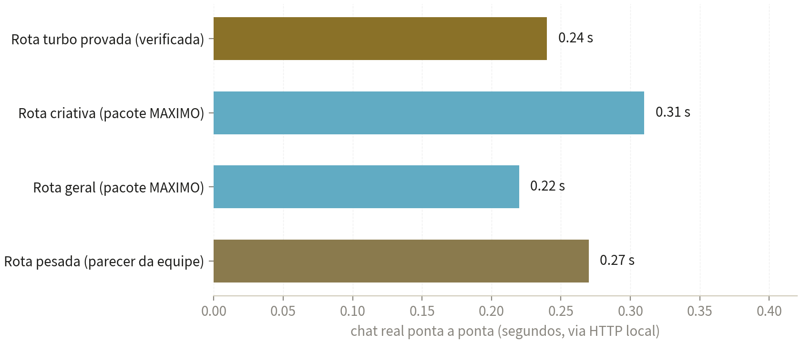
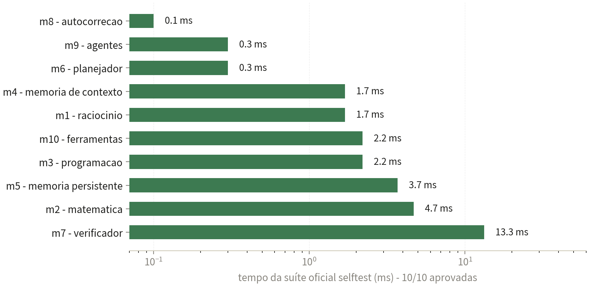

<h1 align="center">🧠 S160 — Orquestrador Completo</h1>

  <b>Teste técnico real</b> · Medido na máquina em 05/11/2026 ·
  <b>S160® — marca registrada de Samuel Fernandes</b>

> **Propriedade intelectual de Samuel Ribeiro Fernandes** — © 2026, todos os direitos reservados.
> Nenhum código-fonte é divulgado: apenas comportamento observado e métricas medidas.

---

## ⚡ O resultado em números

| | |
|---|---|
| **0,24 s** | chat real ponta a ponta com resposta **provada e verificada** (turbo) |
| **10 / 10** | módulos de capacidades aprovados na suíte oficial — **106 verificações** |
| **+1 episódio** | memória episódica gravada automaticamente no cofre S40 após o chat |
| **0,01 s** | primeiro trecho da resposta em streaming (TTFT) |

## 💬 Chat real: as rotas medidas (HTTP local, streaming)

| Rota provocada | Tempo | Veredicto do teste |
|---|---|---|
| **Turbo** (47×23+150) | 0,24 s | correta (**1231**) com 2 caminhos independentes + selo *verificado* |
| Geral (memória RAM) | 0,22 s | assumida pelo pacote de capacidades (7 fases) |
| Honestidade (capital da França) | 0,28 s | **sem resposta inventada**: recusa honesta, sem alucinação |
| Criativa (poema do sertão) | 0,31 s | assumida pelo pacote, sem alucinar conteúdo |
| **Pesada** (modo profundo) | 0,27 s | parecer consolidado da **equipe de agentes** (2.496 caracteres) |

Assinatura própria nas respostas: *processo replicado do turbo em 7 fases com verificação — sem rede, sem API, 100% local* — e a rota usada declarada em cada resposta.

## 🧪 Suíte oficial dos 10 módulos (aprovada na máquina real)

| Módulo | Papel | Checagens | Tempo |
|---|---|---|---|
| m1 — raciocínio | estrutura o raciocínio por tipo de pergunta | 12/12 | 1,7 ms |
| m2 — matemática | cálculo exato, sequências, estatística | 20/20 | 4,7 ms |
| m3 — programação | esqueletos, sintaxe, revisão de código | 12/12 | 2,2 ms |
| m4 — memória de contexto | janela de conversa, temas, entidades | 7/7 | 1,7 ms |
| m5 — memória persistente | fatos com confiança e reforço | 11/11 | 3,7 ms |
| m6 — planejador | planos com passos e replanejamento | 10/10 | 0,3 ms |
| m7 — verificador | requisitos, contradições, aprovação | 8/8 | 13,3 ms |
| m8 — autocorreção | re-tentativa com estratégia aprendida | 7/7 | 0,1 ms |
| m9 — agentes | equipe com escolha e fusão de respostas | 7/7 | 0,3 ms |
| m10 — ferramentas | registro seguro de ferramentas nativas | 12/12 | 2,2 ms |

## 📈 Gráficos medidos

## 🔩 A tecnologia real do S160

- **Roteador de 3 cérebros**: turbo primeiro (responde ou recusa honestamente), pacote de capacidades em seguida, rota pesada S80 quando o usuário pede profundidade — e recusas honestas nunca chegam ao usuário como resposta errada.
- **Vivo e medido**: cálculo novo `(12×12+5³)/7` respondido em 0,08 ms **com os passos explicados**; sequência 2, 6, 12, 20, 30 classificada como quadrática e completada com **42**.
- **Ciclo de memória provado**: episódios no cofre S40 subiram de 25 → 26 durante o chat real; relembramento abaixo de 1 ms (ver dossiê do S40).
- **Serviços vivos**: orquestrador web (53.228 bytes de página, 19,8 ms), núcleo de geração 9B vivo, cérebro pesado declarado pelo `/api/eu`.

**Em resumo: o S160 comanda.**

## 🗂️ Arquivos

| Arquivo | Conteúdo |
|---|---|
| [`RELATORIO-S160-ORQUESTRADOR.pdf`](RELATORIO-S160-ORQUESTRADOR.pdf) | Relatório técnico completo (7 páginas) |
| [`TESTE-S160.json`](TESTE-S160.json) | Medições brutas da rodada |
| `fig_s160_rotas.png` · `fig_s160_modulos.png` | Gráficos medidos |

## ⚖️ Aviso legal

**S160** é marca registrada de Samuel Fernandes e propriedade intelectual exclusiva de **Samuel Ribeiro Fernandes**, com todos os direitos reservados. Nenhum código-fonte é divulgado neste repositório.

© 2026 Samuel Ribeiro Fernandes. Todos os direitos reservados.
