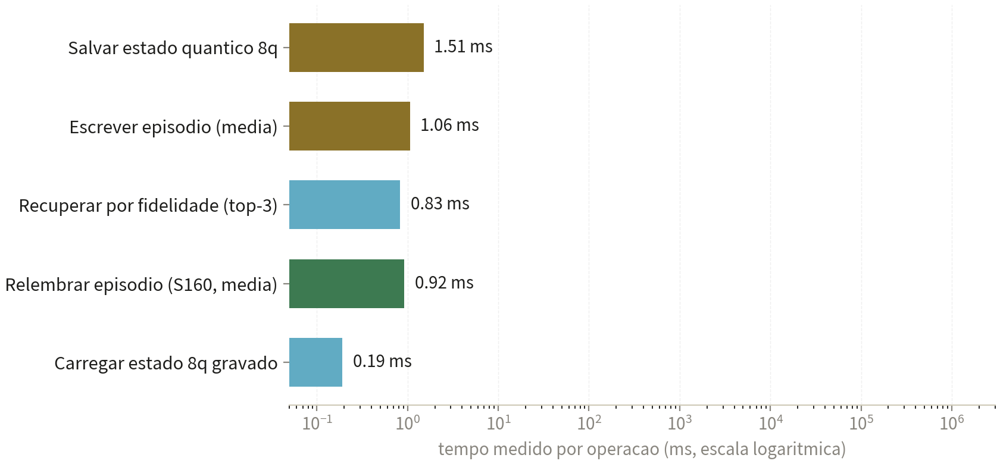
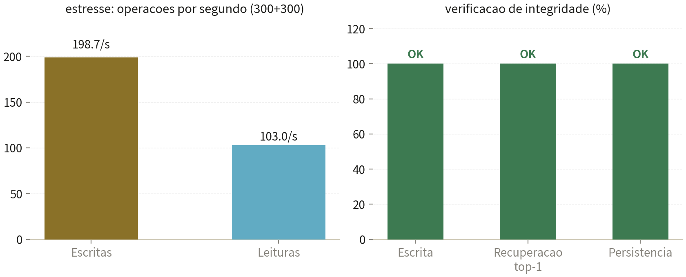

<h1 align="center">🔐 S40 — Cofre de Memória Episódica</h1>

  <b>Teste técnico real</b> · Medido na máquina em 05/11/2026 ·
  <b>S40® — marca registrada de Samuel Fernandes</b>

> **Propriedade intelectual de Samuel Ribeiro Fernandes** — © 2026, todos os direitos reservados.
> Nenhum código-fonte é divulgado: apenas comportamento observado e métricas medidas.

---

## ⚡ O resultado em números

| | |
|---|---|
| **1,065 ms** | tempo médio por escrita no cofre (30 vetores, 32 dimensões) |
| **100 %** | acerto no **top-1** da recuperação por fidelidade (10/10 consultas exatas) |
| **198,7/s** | gravações por segundo sustentadas no estresse (300 escritas seguidas) |
| **0,192 ms** | recarregar do disco um estado quântico de 8 qubits salvo antes |

## 🧪 O que foi testado (tudo real, na máquina)

| Teste | Resultado medido | Veredicto |
|---|---|---|
| Escrita (30 vetores de 32 dim.) | 32,32 ms total · média 1,065 ms · pico 1,978 ms | ✅ |
| Recuperação por fidelidade (top-3) | 0,828 ms; vetor correto em 1º em 10/10 exatas | ✅ |
| Estado quântico 8q salvo e recarregado | vetor **idêntico** bit a bit após ida e volta | ✅ |
| Persistência (fechar e reabrir) | 32 entradas intactas; estado ainda legível | ✅ |
| Estresse (300 escritas + 300 leituras) | 198,7 escritas/s · 103 leituras/s · sem falha | ✅ |
| Relembrar episódios reais (via S160) | 0,73 a 1,05 ms por consulta, com acertos | ✅ |

## 📈 Gráficos medidos

## 🔩 A tecnologia real do S40

- **Formato proprietário `S80-MEMORY/1`**: vetores serializados no disco, transacional por escrita — um travamento não corrompe o cofre.
- **Superfície pública enxuta**: grava vetor nomeado, recupera por fidelidade, salva/carrega estado de registrador quântico, registra circuitos e resultados, expõe status.
- **Memória quântica persistente**: o registrador de 8 qubits do S80 sobrevive ao desligamento — o S40 lembra o que o S80 calcula.
- **Ciclo com o S160**: a cada resposta relevante, o orquestrador grava o episódio; na pergunta seguinte ele volta em menos de 1 ms.

**Em resumo: o S40 lembra.**

## 🗂️ Arquivos

| Arquivo | Conteúdo |
|---|---|
| [`RELATORIO-S40-COFRE-DE-MEMORIA.pdf`](RELATORIO-S40-COFRE-DE-MEMORIA.pdf) | Relatório técnico completo (7 páginas) |
| [`TESTE-S40.json`](TESTE-S40.json) | Medições brutas da rodada |
| `fig_s40_ops.png` · `fig_s40_ciclo.png` | Gráficos medidos |

## ⚖️ Aviso legal

**S40** é marca registrada de Samuel Fernandes e propriedade intelectual exclusiva de **Samuel Ribeiro Fernandes**, com todos os direitos reservados. Nenhum código-fonte é divulgado neste repositório.

© 2026 Samuel Ribeiro Fernandes. Todos os direitos reservados.
