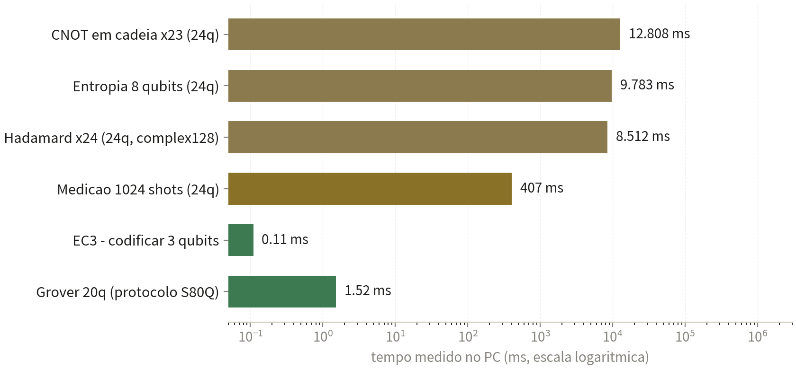
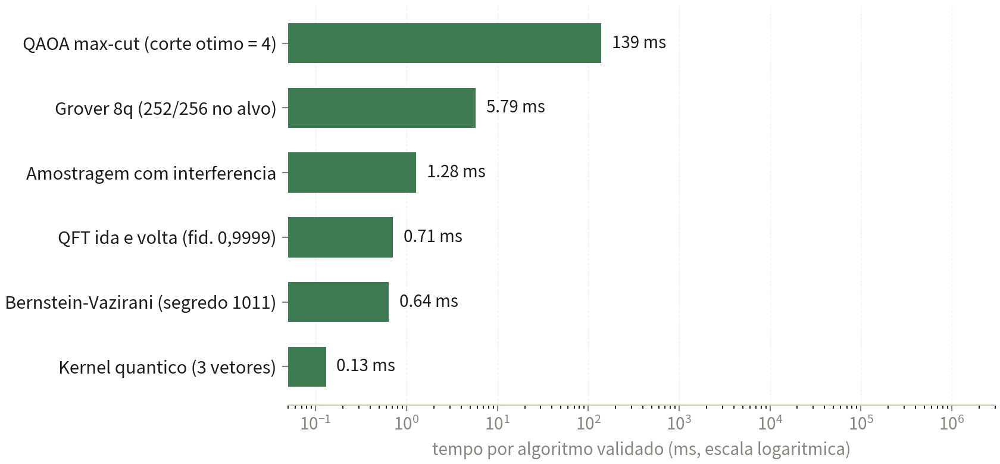

<h1 align="center">⚛️ S80 — Simulador Quântico de 24 Qubits</h1>

  <b>Teste técnico real</b> · Medido na máquina em 05/11/2026 ·
  <b>S80® — marca registrada de Samuel Fernandes</b>

> **Propriedade intelectual de Samuel Ribeiro Fernandes** — © 2026, todos os direitos reservados.
> Nenhum código-fonte é divulgado: apenas comportamento observado e métricas medidas.

---

## ⚡ O resultado em números

| | |
|---|---|
| **50 / 50** | física de Bell **exata**: só 00 e 11 nas medições (1.027 × 1.021 em 2.048 shots) |
| **1,52 ms** | Grover de **20 qubits** pelo protocolo S80Q |
| **0,9999...** | fidelidade do QFT ida-e-volta (limite numérico do double) |
| **8 ops** | operações nativas do protocolo remoto S80Q |

## 🧪 Algoritmos validados (tudo real, na máquina)

| Algoritmo | Critério | Resultado medido | Tempo |
|---|---|---|---|
| Bernstein-Vazirani | acha o segredo escondido | **1011 correto**, 64/64 shots | 0,64 ms |
| Grover 8 qubits | alvo domina a amostragem | **252/256 no alvo** (98,4%), 13 iterações | 5,79 ms |
| QFT ida e volta | fidelidade ≈ 1 | **0,9999999999999991** | 0,71 ms |
| Swap test | 1,0 iguais · menor p/ diferentes | **1,0 vs 0,475** | 0,35 ms |
| Kernel quântico | parecidos altos, distintos baixos | **0,971 vs 0,0008** | 0,13 ms |
| QAOA max-cut | corte ótimo do grafo | **valor 4 (ótimo)** no quadrado | 139,3 ms |
| Amostragem interferente | distribui conforme pesos | concluída | 1,28 ms |

## 📈 Gráficos medidos

## 🔩 A tecnologia real do S80

- **Estado vetorial completo**: 16.777.216 amplitudes complex128 em RAM (268 MB) — simulação honesta, sem atalho.
- **16 portas** de 1 e 2 qubits (H, X, Y, Z, S, T, RX, RY, RZ, P, CNOT, CZ, CP, SWAP, CCX, CSWAP), oráculo de fase, medição por amostragem e colapso, paridade, valor esperado Z e correção de erro **EC3**.
- **Protocolo remoto S80Q**: pacotes versionados com 8 operações nativas (grover, qft, kernel, qaoa, swaptest, sample, ec, run) e roteador de **7 intenções** — `buscar→grover`, `comparar→swaptest`, `diversificar→sample`, `otimizar→qaoa`, `executar→run`, `verificar→ec`, `fourier→qft`.
- **Cadeia real medida**: intenção `buscar` → Grover 12q → alvo em **1.024/1.024 shots** após 50 iterações, em 131 ms completo.
- **A parede exponencial é real**: Hadamard ×24 custa 8,5 s (16,7 milhões de amplitudes em CPU de 2012 sem AVX2); 40 qubits pediriam **17,6 TB** de RAM.

**Em resumo: o S80 calcula.**

## 🗂️ Arquivos

| Arquivo | Conteúdo |
|---|---|
| [`RELATORIO-S80-SIMULADOR-QUANTICO.pdf`](RELATORIO-S80-SIMULADOR-QUANTICO.pdf) | Relatório técnico completo (7 páginas) |
| [`TESTE-S80.json`](TESTE-S80.json) | Medições brutas da rodada |
| `fig_s80_wall.png` · `fig_s80_algos.png` | Gráficos medidos |

## ⚖️ Aviso legal

**S80** é marca registrada de Samuel Fernandes e propriedade intelectual exclusiva de **Samuel Ribeiro Fernandes**, com todos os direitos reservados. Nenhum código-fonte é divulgado neste repositório.

© 2026 Samuel Ribeiro Fernandes. Todos os direitos reservados.
